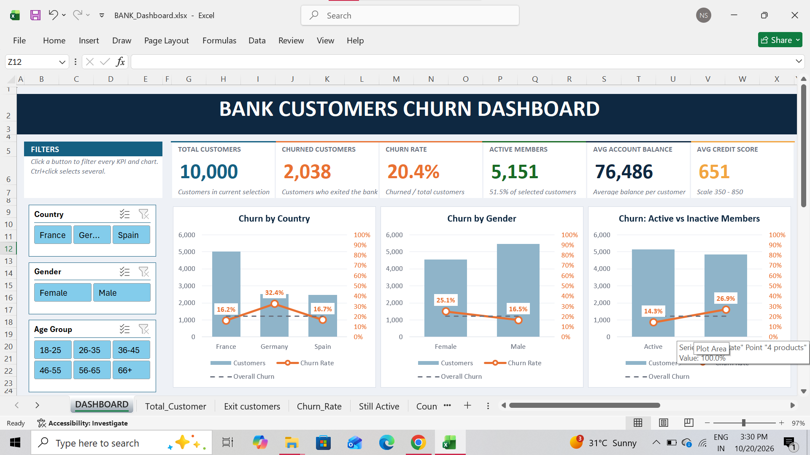
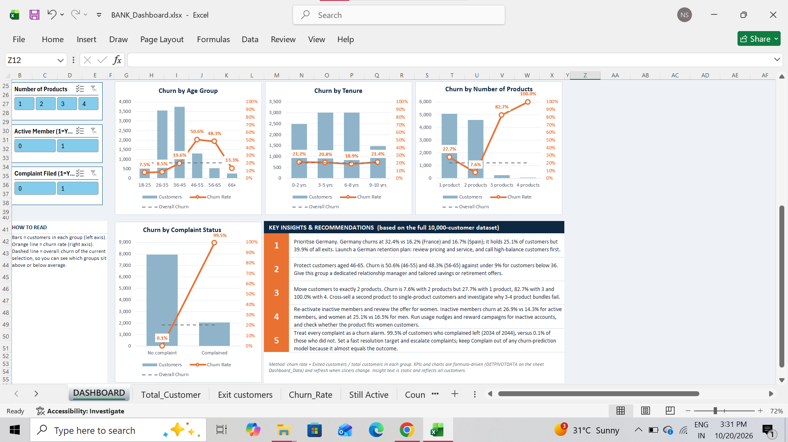

# Bank Customer Churn Dashboard

An interactive Excel dashboard that shows **why bank customers leave** and what the bank can do about it.

**Tools:** Excel | Power Query | Pivot Tables | Slicers | GETPIVOTDATA | Claude AI (used to speed up analysis and wording)
DASHBOARD OVERVIEW[

]
---

## The Problem
A bank loses customers every year. Which customers are leaving, and why? Where should the bank act first?

## The Data
- 10,000 bank customers across France, Germany and Spain
- 19 columns: age, gender, country, balance, credit score, number of products, active status, complaints and more.

## What I Did
1. **Cleaned the data** with Power Query (checked for missing values and duplicates, made age and tenure groups)
2. **Built 10 pivot tables** (country, gender, age group, tenure, complaints, products, active vs inactive)
3. **Built one dashboard** with 6 KPIs, 7 charts and slicers. Click a button and every number and chart updates
4. **Wrote 5 recommendations** with estimated impact

## Key Numbers
| KPI | Value |
|---|---|
| Total customers | 10,000 |
| Churned customers | 2,038 |
| Churn rate | 20.4% |
| Active members | 5,151 |
| Average balance | 76,486 |
| Average credit score | 651 |

## What I Found
- **Germany:** 32.4% churn, double France (16.2%) and Spain (16.7%). It has 25% of customers but 40% of all exits.
- 👴 **Age 46-65:** about 50% churn. Customers under 36: below 9%.
- 📦 **Products:** 2 products = 7.6% churn. 1 product = 27.7%. 3 products = 82.7%. 4 products = 100%.
- 😴 **Inactive members:** 26.9% churn vs 14.3% for active members.
- 👩 **Gender:** women 25.1% vs men 16.5%.
- 🚨 **Complaints:** 99.5% of customers who complained left (2,034 of 2,044).

## Recommendations and Estimated Impact
*These are what-if estimates from the data, not real results. Each estimate is separate because the groups overlap.*

| Action | Estimated effect |
|---|---|
| Germany retention plan | Bring churn to France's level (32.4% to 16.2%): about 408 fewer exits. Overall churn goes from 20.4% to 16.3% |
| Dedicated manager for ages 46-65 | A 10-point drop in churn: about 185 customers saved |
| Cross-sell a second product | Move 10% of single-product customers to 2 products: about 102 fewer exits |
| Re-activate inactive members | Match the active churn rate (14.3%): about 611 fewer exits |
| Fast complaint handling | Keep 10% of complainers: about 203 customers and 18.5M in balances |

## Important Note
The **Complain** column almost equals the outcome (99.5%), so it should be left out of any churn prediction model. Using it would make the model look perfect without being useful.

## Limits
- The data is a fixed file, not live data
- The analysis shows links between factors, not proof of cause
- Impact numbers are estimates

## Files
- `BANK_Dashboard.xlsx` - the full workbook (raw data, pivot tables, dashboard)
- `images/` - dashboard screenshots
- `README.md` - this file

## How to Use
Download `BANK_Dashboard.xlsx`, open it in Excel (desktop version for slicers to work), go to the **DASHBOARD** sheet and click the filter buttons.

## About Me
**Nikhil Sharma** -  Data Analyst | Delhi, India
GitHub: [nik09-DA](https://github.com/nik09-DA)
